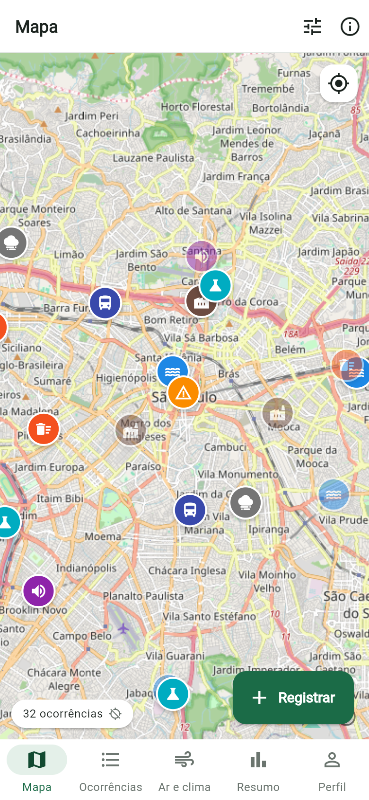
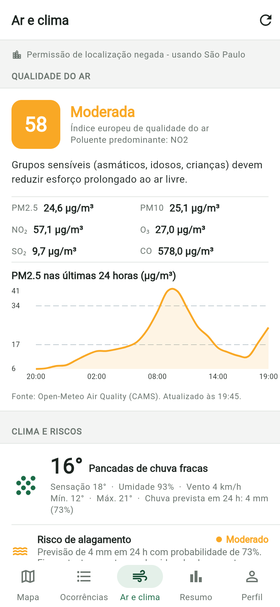
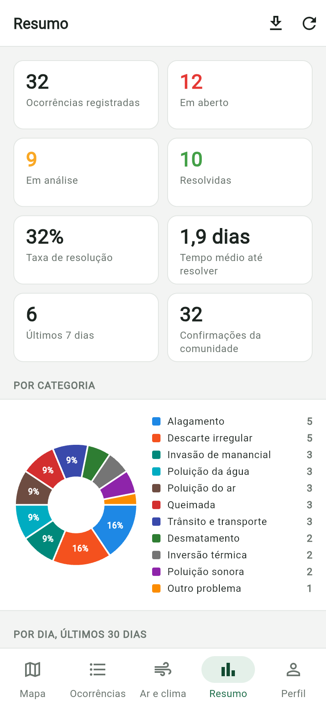

# EcoAlerta

Sistema distribuído para dispositivo móvel de registro e acompanhamento de ocorrências ambientais urbanas: alagamentos, poluição do ar, descarte irregular, desmatamento, queimadas, ocupação de mananciais, trânsito e transporte, inversão térmica, poluição sonora e da água.

Trabalho das Atividades Práticas Supervisionadas (APS) 2026/2 do curso de Ciência da Computação da UNIP, campus Santos (Rangel), 7º e 8º semestres, disciplina Desenvolvimento de Sistemas Distribuídos (DSD).

| Integrante | RA |
|---|---|
| Christian Santos | F352870 |
| Lucas Pascoal Antunes | N093BA4 |

Professor supervisor: Vinícius Eduardo

## Estrutura

| Parte | Tecnologia | Pasta |
|---|---|---|
| Servidor (API REST, WebSocket, coletor e painel web) | Rust, Axum 0.8, Tokio, sqlx/SQLite | `server/` |
| Aplicativo móvel (Android, também compila para web) | Flutter 3.44, Dart 3.12, Riverpod 3, flutter_map, geolocator | `app/` |
| Trabalho escrito, figuras e capturas de tela | PDF | `docs/` |

O trabalho escrito está em [docs/APS_EcoAlerta_Sistema_Distribuido_Movel.pdf](docs/APS_EcoAlerta_Sistema_Distribuido_Movel.pdf).

O APK do aplicativo e o executável do servidor para Windows estão na página de [Releases](../../releases).

## Telas

| Mapa | Ocorrências | Ar e clima | Resumo |
|---|---|---|---|
|  |  |  |  |

## Servidor

```bash
cd server
cargo build --release
./target/release/ecoalerta-server
```

Na primeira execução o servidor cria o banco `ecoalerta.db` (SQLite), a pasta `uploads/` e os dados de demonstração: 4 usuários, 6 pontos monitorados e 32 ocorrências em São Paulo nos últimos 30 dias.

* Painel web: <http://localhost:8080/>
* Saúde do servidor: <http://localhost:8080/api/health>
* Contas de demonstração: `gestor@ecoalerta.app` / `gestor123` (gestor), `ana@ecoalerta.app` / `123456`, `bruno@ecoalerta.app` / `123456`

Variáveis de ambiente opcionais: `PORTA` (8080), `BANCO` (ecoalerta.db), `JWT_SECRET`, `COLETA_MINUTOS` (30) e `UPLOADS` (uploads).

## Aplicativo

```bash
cd app
flutter pub get
flutter run
flutter build apk --release
```

No emulador Android o aplicativo usa `http://10.0.2.2:8080`, que é o localhost do computador. Em um celular real, abra Perfil, depois Servidor, e informe `http://IP-do-PC:8080` com o aparelho na mesma rede Wi-Fi.

Para o GPS do emulador apontar para São Paulo:

```bash
adb emu geo fix -46.6333 -23.5505
```

## Roteiro de demonstração

1. Iniciar o servidor e abrir o painel web no computador.
2. Entrar no aplicativo como Ana e percorrer mapa, filtros, detalhe e lista de ocorrências próximas.
3. Registrar uma ocorrência com foto e ponto no mapa. O evento aparece no painel web em tempo real.
4. Abrir a tela Ar e clima: qualidade do ar, clima, riscos de alagamento e de inversão térmica e histórico dos pontos monitorados.
5. Abrir o Resumo e exportar a planilha CSV.
6. Entrar como gestor em um segundo aparelho e alterar a situação de uma ocorrência. O primeiro aparelho recebe o aviso.
7. Ligar o modo avião, registrar uma ocorrência (ela vai para a fila offline) e religar a rede. O envio acontece sozinho.

## Fontes de dados

Qualidade do ar e clima: Open-Meteo (CAMS/Copernicus). Mapas e endereços: OpenStreetMap e Nominatim.
